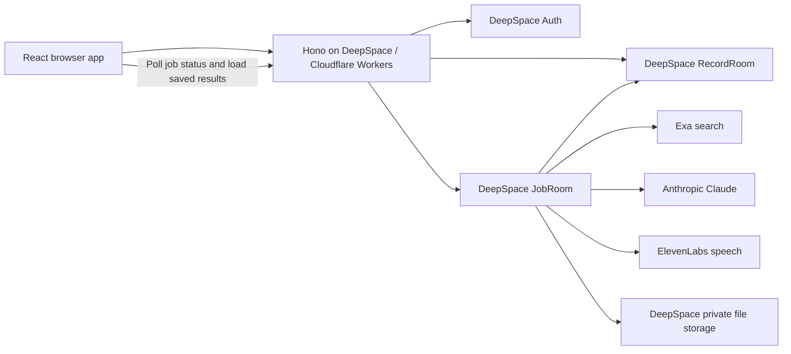

# Signal

*Stay curious. Stay informed.*

Signal turns a reader’s interests into a short, source-backed news briefing and a single-narrator podcast. It was built for the DeepSpace Software Engineering Internship assessment.

**[Open the live Signal app](https://signal.app.space)**

## Try the core flow

1. Sign in through DeepSpace Auth. On your first visit, choose broad interests such as Music, Science, or Gaming. Add optional specifics like “hip-hop,” “space missions,” or “GTA VI.”
2. On **Feed**, click **Generate stories**. Signal researches recent coverage and writes up to three reports. Open a story to read it and inspect its original sources.
3. On **Podcasts**, click **Generate podcast**. Signal writes the narration from your latest saved reports, generates audio, and saves the episode with its transcript and sources.
4. Choose a date in **Story archive** or **Podcasts** to find items saved on that day. Edit your interests or profile in **Settings**.

Generation is manual. The Feed rolls over at **5 a.m. MST (12:00 UTC)**. The archive uses the Mountain calendar date, so today is selectable after midnight and saved stories remain available across Feed rollovers. Sign-out leaves saved content available for the next session.

## Architecture

Signal uses React 19, Vite, TypeScript, Tailwind CSS, and the DeepSpace SDK pinned to **0.44.2**. A Hono Worker on DeepSpace serves the frontend assets and authenticated app APIs from the same origin. The public landing page is prerendered, and the signed-in routes load the DeepSpace Auth and records providers.



| DeepSpace primitive | Role in Signal |
| --- | --- |
| Auth and protected routes | Sign-in and session restoration. Server actions verify the caller separately from the client route guard. |
| RecordRoom and collection schemas | Store reader profiles, story editions, and podcast metadata in the application’s native database. |
| JobRoom | Queues manual generation so a browser request can return promptly. Stores generation state and coordinates duplicate requests and daily usage limits. |
| Integration proxy | Makes server-side Exa, Claude, and ElevenLabs calls through the owner’s DeepSpace credentials. |
| App file storage | Stores each MP3 under the authenticated reader’s private scope; the episode record stores its playback reference. |
| CLI deployment | Publishes the Worker and assets and supplies the app identity and platform bindings on DeepSpace. |

### Data model

| Collection | Contents |
| --- | --- |
| `profiles` | Per-reader record keyed by authenticated user ID. Stores categories, optional focus terms, display name, and contact email. |
| `reportEditions` | Private reader ID, edition and month indexes, and the report payload. Each payload contains its creation timestamp, story sections, category labels, and source metadata and citations. |
| `podcastEpisodes` | Private reader ID, job ID, publication time, transcript, sources, supporting report ID, and private audio reference. Each successful episode gets its own record and file. |
| `briefings` | Compatibility for the earlier snapshot format. An existing snapshot can still supply its saved report and most recent saved episode. |

Privileged server actions scope record access to the verified caller. Paid endpoints are kept behind generation jobs, and browser requests never receive provider credentials. Account deletion removes Signal’s records and audio for that user. It does not close the user’s DeepSpace account.

### Research and generation

1. **Plan.** Claude groups the reader’s interests into up to three research themes. A single category goes straight to research. The backend verifies that a returned plan includes each supplied category exactly once.
2. **Research.** Exa searches a 48-hour news window using the reader’s categories and focus terms. Signal normalizes URLs, removes duplicates within a research group, filters for topical coverage, and screens out election and political coverage. It treats web excerpts as untrusted input.
3. **Write and validate.** Claude receives a bounded set of excerpts with backend-assigned source IDs. Signal validates each draft at runtime and rejects citations outside its source group. A group with weak coverage can be omitted, and a valid draft can survive a malformed sibling.
4. **Narrate.** Claude writes a script from saved reports without repeating web search. The script’s length adapts to the available material, and citations are checked before ElevenLabs generates the audio.
5. **Persist.** The Worker saves verified reports, or saves the audio and the corresponding episode record. The browser polls status and reads the saved result.

| Integration | Why it belongs |
| --- | --- |
| `exa/search` | Retrieves current source material and original URLs for citations. |
| `anthropic/chat-completion` | Groups related interests, synthesizes the reports, and writes the podcast narration. |
| `elevenlabs/generate-speech` | Produces single-narrator MP3 audio from the validated script. |

The report and podcast flows use the app owner’s DeepSpace integration credits. Creating an account and loading saved content do not trigger generation. Signal bounds per-reader attempts and total daily attempts and deduplicates pending requests. See [DeepSpace’s external integrations guide](https://docs.deep.space/guides/external-apis.md) and [owner-billed worker context](https://docs.deep.space/guides/scheduled-jobs.md#the-cron-context).

### Main engineering tradeoff

Manual, bounded generation keeps the core flow easy to demonstrate, caps idle spending, and lets readers decide when to refresh. It gives up an automatically populated morning feed. Durable jobs preserve the processing state across browser reloads and keep the HTTP request brief, at the cost of an asynchronous status flow and deliberate retry handling. Reusing the saved reports for podcast production also reduces provider calls and keeps the written and spoken versions tied to the same evidence.

### Scope and limitations

- Source ID validation ensures a citation points to supplied evidence. It cannot guarantee that every sentence is supported. Political filtering is also imperfect. The interface labels generated material and links to sources.
- The Feed can return fewer than three reports. Sparse coverage, provider errors, and exhausted credits can prevent an edition or episode from being generated.
- An older release only retained the most recent podcast’s metadata. New episodes have independent archive records. Previously overwritten metadata is outside the current archive.
- Editorial sizing and source links were prioritized over article imagery, separate article permalink routes, bookmarks, and automated delivery. A next step would be evaluating topical relevance and claim-level sourcing using a small, reviewed set of real editions.

## Local development

Use a Node.js version supported by `package.json` and npm 11.6 or newer. This project was developed with Node.js 24.

```bash
git clone https://github.com/arorakunj/signal.git
cd signal
npm ci
npx deepspace auth login
npx deepspace auth whoami
npm run dev
```

Open `http://localhost:5173`. The DeepSpace CLI starts Vite with a local Worker runtime and writes the environment for platform services to `.dev.vars`. Use an account authorized for this app when exercising its live integrations. Provider API keys are unnecessary for these managed integrations. Keep `.dev.vars`, `.env` files, CLI sessions, and test account state private.

```bash
npm run validate
npm run lint
npm run build
npx deepspace test run all --port 5193
```

The full browser suite uses two usable DeepSpace test accounts for authenticated and cross-account tests. Tests that require the fixture skip when those accounts are unavailable. Create or recover test accounts through the CLI, separate from your reviewer account. [DeepSpace testing guide](https://docs.deep.space/guides/testing.md)

## Deploy to DeepSpace

From the repository root, use the owner’s or an authorized collaborator’s CLI session:

```bash
git status --short
npx deepspace auth whoami
npx deepspace app source
npx deepspace deploy
```

Use the URL printed by the CLI for the assessment submission. A GitHub push updates the repository. The DeepSpace deployment command publishes the local checkout and provisions the Worker bindings. For a GitHub-sourced app, deploy from a clean, pushed checkout so the release corresponds to what reviewers see in the repository. An unclaimed app’s first deploy can latch the selected GitHub remote as its source, while an existing app keeps its configured source. [DeepSpace source control](https://docs.deep.space/guides/source-control.md)

### Production smoke test

1. Open the published URL in a private window. Confirm direct navigation to `/feed`, `/archive`, `/podcasts`, and `/settings` requires sign-in.
2. Sign in with a test reader, save interests, reload, and confirm they persist. Generate one story edition and check the original source links.
3. Open **Story archive** and select the date of that edition. Generate one podcast and confirm playback, transcript, and sources. Reload and confirm both the edition and episode remain available.
4. With a second test reader, check that their account cannot see the first reader’s archive or fetch the first reader’s private audio URL.

One story run and one podcast run are sufficient for the production smoke test and consume live integration credits.

## Code map

| Path | Responsibility |
| --- | --- |
| `worker.ts`, `wrangler.toml` | Hono assembly, assets, and DeepSpace Worker bindings |
| `src/pages/`, `src/components/` | Landing page, signed-in pages, onboarding, player, and date-picker views |
| `src/actions/`, `src/server/action-routes.ts` | Authenticated reads and mutations, including job submission and archive queries |
| `src/server/briefing-room.ts`, `src/jobs.ts` | Job admission, status, quotas, and persistence |
| `src/server/briefing-pipeline.ts`, `src/lib/briefing.ts` | Integrations, prompts, source rules, and runtime schemas |
| `src/lib/edition.ts`, `src/schemas/` | Date boundaries and collection definitions |
| `tests/`, `src/**/*.test.ts` | Browser, API, and unit regression coverage |
